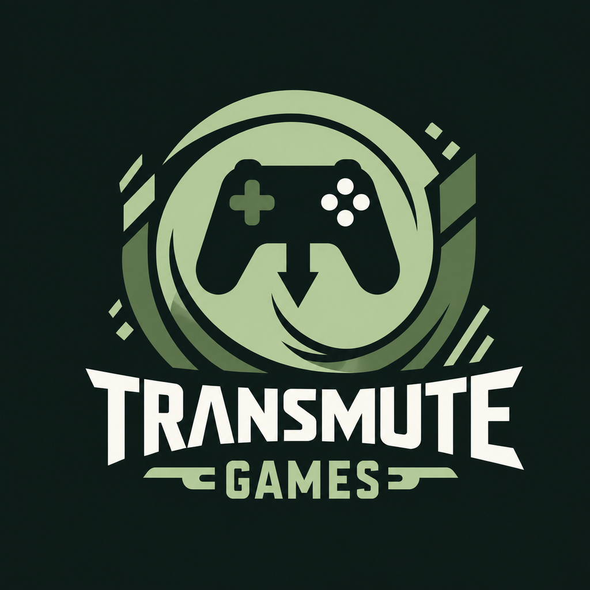
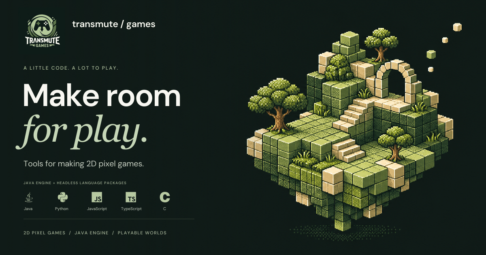
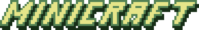

<h1 align="left">
  
  Transmute Games
</h1>

<strong>A little code. A lot to play.</strong>

  <a href="https://github.com/orgs/transmute-games/repositories">Explore our repositories</a> ·
  <a href="https://github.com/transmute-games/transmute-core/blob/master/docs/README.md">Start building</a>

We build tools for making 2D pixel games. Transmute Core provides the engine;
games like Minicraft put it to work. Start with a small idea, give it a world,
and make something you can play.

## Tools and games

| Logo | Project | What you can make with it |
| :--- | :--- | :--- |
|  | [**Transmute Core**](https://github.com/transmute-games/transmute-core) | A Java engine for 2D pixel games, with sprites, audio, tile worlds, and physics. Build a platformer, a top-down world, or your own kind of game. |
|  | [**Minicraft**](https://github.com/transmute-games/minicraft) | A Minicraft+ adaptation running on Transmute Core. Explore a survival world in singleplayer or play together over a LAN. |

<h2 align="left">
  
  <a href="https://github.com/transmute-games/transmute-core">Transmute Core</a>
</h2>

**Small engine. Whole worlds.** A focused engine for 2D pixel games, with a fixed
timestep loop and hardware-accelerated rendering. Its CLI scaffolds basic,
platformer, and RPG projects so you can get to a playable starting point.

Build in Java, then check your game without opening a window. Headless playtests
can simulate input and assert pixels, game state, and audio.

[Explore the engine](https://github.com/transmute-games/transmute-core) ·
[Get started](https://github.com/transmute-games/transmute-core/blob/master/docs/README.md) ·
[See the examples](https://github.com/transmute-games/transmute-core/blob/master/docs/EXAMPLES.md)

## How we build

- **Make every pixel count.** Keep the tools focused on the games people want to make.
- **Get to playable.** Give small ideas a working starting point, then build from there.
- **Test what happens.** Check game behavior with repeatable playtests, including runs without a display.

Found a bug or have an idea? Open an issue in the project’s repository.

  <strong>Small tools. Whole worlds.</strong> 
  <a href="https://github.com/orgs/transmute-games/repositories">Find your next project →</a>

